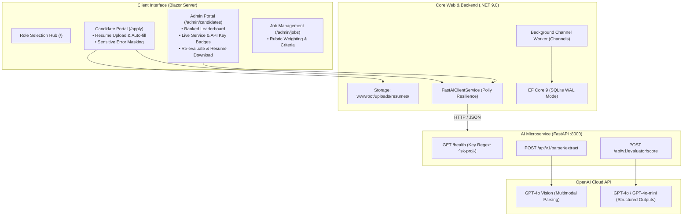

# myATS — Intelligent Applicant Tracking & AI Rubric Scoring System

[](https://dotnet.microsoft.com/)
[](https://fastapi.tiangolo.com/)
[](https://openai.com/)
[](https://www.sqlite.org/)

An end-to-end, privacy-conscious Applicant Tracking System (ATS) combining a high-performance **ASP.NET Core Blazor (.NET 9.0)** web platform with a **Python FastAPI** AI microservice for Vision LLM resume parsing and rubric-driven candidate ranking.

---

## 🌟 Key Features

- **Multimodal AI Vision Resume Extraction:** Leverages OpenAI `gpt-4o` multimodal capabilities to extract structured profile information (Contact info, Work Experience, Education, Skills, and Certifications) from complex PDF layouts and images.
- **Sensitive Error Masking & Applicant Privacy:** Zero raw exceptions or backend stack traces are ever exposed to applicants. If the AI service is offline or unconfigured, candidates are presented with a polite message and can submit manually without impediment.
- **Objective Rubric Scoring & Leaderboard:** Evaluates applicants against customizable job criteria and weighted categories using `gpt-4o-mini`. Candidates are ranked in real time with cut-off threshold filtering (`Qualified` vs `Filtered Out`).
- **No Synthetic Heuristic Scoring:** Evaluations are never polluted with synthetic guesses. If the AI service is unreachable, scoring is safely paused with status `ManualReviewNeeded` and score `Paused (0.0)` for manual review or one-click recruiter re-evaluation.
- **Live Diagnostics & OpenAI Key Regex Validation:** Microservice health probe validates OpenAI Project API keys (`^sk-proj-[A-Za-z0-9_\-]{20,}$`) and provides live visual status badges (Online, Invalid Key, Offline) with quick-recheck controls.
- **Role-Based Access Control (RBAC):** Built-in Role Selection hub (`/`) with circuit-scoped state isolating Candidate flows from Recruiter / Administrator tools.
- **Physical Resume Storage & Secure Download:** Resumes are securely saved to disk (`wwwroot/uploads/resumes/`) and can be inspected or downloaded directly from the candidate leaderboard.
- **High-Concurrency Persistence:** SQLite with Write-Ahead Logging (`PRAGMA journal_mode=WAL;`) and a busy timeout (`PRAGMA busy_timeout=5000;`) paired with asynchronous background evaluation queues (`System.Threading.Channels`).

---

## 🏗️ System Architecture



---

## 📋 Prerequisites

1. **[.NET 9.0 SDK](https://dotnet.microsoft.com/download/dotnet/9.0)** (v9.0.100 or newer)
2. **Python 3.10 – 3.12**
3. **OpenAI API Key** (Project key beginning with `sk-proj-`)

---

## 🚀 Quick Start Guide

### 1. Clone the Repository
```bash
git clone https://github.com/<your-username>/myATS.git
cd myATS
```

---

### 2. Configure & Start the Python AI Microservice

```powershell
cd src/ats_ai_service

# Create virtual environment (first time only)
python -m venv venv

# Activate virtual environment
# Windows PowerShell:
.\venv\Scripts\Activate.ps1
# Windows Git Bash:
# source venv/Scripts/activate

# Install dependencies
pip install -r requirements.txt

# Configure environment variables
# Copy .env.example to .env and set your OPENAI_API_KEY
cp .env.example .env

# Run FastAPI server on port 8000
python -m uvicorn main:app --reload --port 8000
```

> **API Key Format:** Ensure your `OPENAI_API_KEY` starts with `sk-proj-`. The service will validate this format on startup.

---

### 3. Run the .NET 9.0 Blazor Application

In a separate terminal:

```powershell
cd src/ATS.Blazor

# Run the Blazor web application
dotnet run
```

Open your browser at:
- **`http://localhost:5277`** (or the URL displayed in your terminal output).

---

## 🧭 Application Walkthrough

| Route | Role | Purpose |
| :--- | :--- | :--- |
| `/` | All | **Role Selection Hub:** Choose between Candidate and Recruiter/Admin view. |
| `/apply` | Candidate | **Job Application & AI Auto-fill:** Upload resume PDF/image, preview auto-extracted details, and submit. Protected by error masking. |
| `/admin/jobs` | Recruiter | **Job Postings & Rubrics:** Configure job descriptions, minimum passing cutoff scores, and category weightings. |
| `/admin/candidates` | Recruiter | **Ranked Candidate Leaderboard:** Real-time composite scoring, qualification badges, live service health status, resume download, and re-evaluation. |
| `/api/resumes/{id}/download` | Recruiter | **Resume Download API:** Secure endpoint to retrieve the original uploaded resume file. |

---

## 🔒 Security & Resilience Standards

- **Error Masking:** Client-facing upload errors are abstracted into user-friendly messages to prevent leakage of internal stack traces, API keys, or provider fault details.
- **Circuit Breakers & Retries:** .NET HTTP calls to the AI microservice are protected by Polly's resilience pipeline (`AttemptTimeout: 20s`, `SamplingDuration: 60s`).
- **Database Concurrency:** SQLite is configured with WAL (`PRAGMA journal_mode=WAL;`) and busy timeout (`PRAGMA busy_timeout=5000;`) to safely isolate concurrent background workers from web requests.
